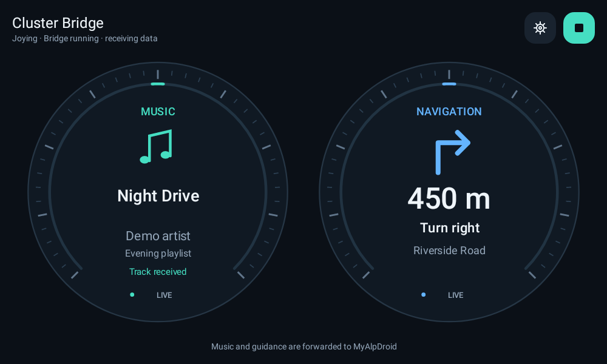

# myalpdroid-zlink-bridge

Bring your CarPlay music and navigation to your Alpine’s instrument cluster.

myalpdroid-zlink-bridge runs on your Android head unit alongside ZLink and MyAlpDroid. Keep using CarPlay as usual: the bridge passes the available track details and turn-by-turn guidance to MyAlpDroid for display behind the steering wheel.

*The app’s dashboard, shown with sample music and navigation data.*

## What you get

- **Music at a glance:** track title, artist and album on the dashboard, with music information forwarded to MyAlpDroid.
- **Navigation in the cluster:** supported turn arrows and distance, plus the road name on the bridge dashboard.
- **Two instrument-style dials:** music and navigation side by side on the head unit, or stacked on a narrow screen.
- **One-touch control:** the top-right play/stop icon starts or stops the bridge. It controls the bridge, not your music.
- **Automatic startup:** enable it once and let the bridge start with the head unit.

Music and navigation have been confirmed working with **Apple Maps and Google Maps** through CarPlay on a **Joying JY-UTS10N4**, with ZLink and MyAlpDroid. Other head units have not been verified.

## Important: cannot coexist with OsmAnd

**The bridge cannot be installed alongside the standard, free OsmAnd app on the same head unit.** It uses OsmAnd’s Android app identity so MyAlpDroid can recognize its navigation service.

If you already have standard OsmAnd installed, back up your saved places and routes, then uninstall it before installing the bridge. Android will not let the bridge update an official OsmAnd installation.

## Getting started

1. Copy the myalpdroid-zlink-bridge APK to your head unit, open it and install it.
2. Open **MyAlpDroid ZLink Bridge** and allow notifications when asked.
3. Tap the **play icon in the top-right corner**. A persistent notification indicates that the bridge is running.
4. Restart MyAlpDroid. Enable **MyAlpDroid ZLink Bridge** in its player settings if listed, and give **MyAlpDroid** notification access in Android’s special app-access settings.
5. Connect your iPhone through ZLink, play some music and start a route in Apple Maps or Google Maps.

The dashboard shows the data the bridge receives. If nothing is available yet, the dials show a waiting message.

## Everyday use

Once started, the bridge runs in the background; you can leave its screen and use ZLink normally. Use the gear icon to open **Settings**.

**Start automatically when the head unit boots** is enabled by default. Tap Start once to activate the bridge. Tapping Stop keeps it off, including after a reboot, until you start it again. Disabling automatic startup leaves manual control available.

The bridge reconnects if the head unit’s data service goes away and returns after standby. If your Joying closes the app in the background, allow it in the head unit’s automatic-start or battery settings. Using Android’s Force stop may require opening and starting the bridge again.

Podcast chapter changes keep the existing podcast name and album when the head unit updates only the chapter title. Explicitly cleared metadata is still cleared.

Some CarPlay sources provide track details without a reliable playback state. The compatibility option in Settings lets MyAlpDroid display those tracks. The dashboard labels them **Track received** rather than claiming confirmed playback.

## Choose the data source

The bridge uses **Joying** by default. This is the interface confirmed working on the head unit.

To try the richer direct feed, open **Settings** and enable **Use ZLink directly (experimental)**. The change applies while the bridge is running, and the chosen source appears on the dashboard. The setting is remembered for automatic startup too.

Direct mode attempts to read music and navigation straight from ZLink. It can forward real roundabout exit angles when ZLink supplies them. Direct access and the resulting cluster graphics still need verification on the head unit; a connected socket alone does not mean metadata is arriving.

If music or navigation stops updating, turn the switch off to return to Joying, then use **Save diagnostics to Downloads**. Switching sources keeps the current log, including the direct connection and decoding information. Starting a new bridge session resets the log.

## What to expect from navigation

- Available guidance depends on the navigation app and the data ZLink and the head unit expose.
- Apple Maps and Google Maps have worked in the owner’s tests. Waze did not supply usable navigation data in that test; its support is not confirmed.
- **Joying mode has no accurate roundabout exit geometry.** Experimental direct ZLink mode forwards a supplied exit angle and driving side to MyAlpDroid. It does not estimate a direction when geometry is missing. This still needs a head-unit drive test.
- Distance follows the live countdown rather than the segment length or zero placeholder sent with a new maneuver.
- Route transitions clear the previous arrow. Guidance also expires if live distance updates stop, even when route-status messages continue.

## If something is missing

Check that the bridge is running, CarPlay is connected in ZLink, and music or a route is active. If the dashboard receives data but the instrument cluster does not, restart MyAlpDroid and check its player settings and notification access.

For troubleshooting, open **Settings → Save diagnostics to Downloads**. This saves a file directly to the head unit’s Downloads folder without needing a document picker. Technical details are available in Settings when needed.

Diagnostics stay on the head unit and may contain track titles, road names and timestamps. Direct mode also records raw ZLink metadata, which can include phone details. The log automatically removes older entries at **2 MiB or 5,000 entries** and keeps recording recent activity. Starting a new bridge session resets it, so save it before restarting if you need to investigate a problem.

## License

myalpdroid-zlink-bridge is licensed under the [GNU General Public License v3.0](LICENSE).
Copyright © 2026 Fred Oranje. Third-party components retain their respective licenses; see the [third-party notices](THIRD_PARTY_NOTICES.md).
